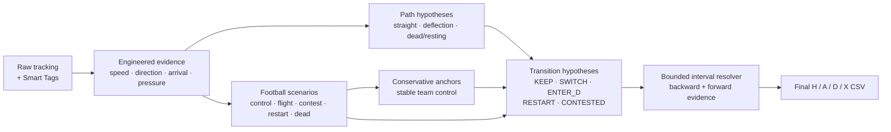

# Frame-level possession for BAR–ATH

## 1. The problem

We label every tactical frame as Home (`H`), Away (`A`), dead ball (`D`), or
not graded (`X`). The difficult part is not recognising a long possession; it
is locating the boundary between states.

The nearest player is not necessarily the player in possession. A nearest
player can be running past the ball, contesting it, receiving a poor touch,
or waiting for a pass. A missing ball coordinate is also ambiguous: it may be
an aerial pass, an occlusion, a deflection, or a stoppage. Smart Tagging gives
useful phase context, but its windows are not exact frame labels.

The full match contains substantially more missing-ball and missing-player
behaviour than the public five-minute window. We therefore treat missing
observations as uncertainty and change labels only when independent football
evidence agrees.

## 2. From observations to evidence

The pipeline keeps four concepts separate:

- **Observations** are direct facts from the supplied data: ball/player
  coordinates when visible, track visibility, Smart Tag phase context, and
  whether a player or ball is missing.
- **Engineered features** are measurements calculated from those facts:
  ball speed, acceleration, direction change, displacement, kick episodes,
  player distance, team distance margin, closing speed, arrival time, density,
  pressure, activity, gap-edge path coherence and uncertainty.
- **Scenarios** combine features into football situations such as
  `CONTROLLED`, `PRESSURED_CONTROL`, `BALL_IN_FLIGHT`,
  `RECEPTION_CANDIDATE`, `CONTESTED`, `DEAD`, `RESTART_LIVE_BOUNDARY` and
  `OCCLUDED`. They describe context; they are not final labels.
- **Anchors** are high-confidence control points. They require compatible
  proximity, team separation, persistence, ball/player motion and subsequent
  control. A nearest-player change alone never creates an anchor.

The main engineered signals answer different football questions:

| Evidence | Football question |
|---|---|
| Ball speed, acceleration, direction and displacement | Is the ball being kicked, received, deflected, or settling? |
| Team distance margin, closing speed and arrival time | Which team could plausibly reach the ball first? |
| Density, pressure and player activity | Is this live control, a contest, or a stoppage? |
| Gap-edge geometry and path coherence | Which hidden-ball path is plausible? |
| Persistence and controlled deceleration after contact | Has a team actually controlled the ball? |
| Restart geometry and activation | Has dead ball ended and live play resumed? |

The case diagrams in [03_scenario_engineering.ipynb](notebooks/03_scenario_engineering.ipynb),
[04_deadball_setpieces.ipynb](notebooks/04_deadball_setpieces.ipynb), and
[04b_ball_missing_player_analysis.ipynb](notebooks/04b_ball_missing_player_analysis.ipynb)
show these distinctions in football context. The latter includes both a local
look-back/look-forward diagram and a full-range animation for missing
ball/player cases.

## 3. Hypothesis-test resolver

The main innovation is a knowledge-driven, rule-based probabilistic resolver.
It is not trained on the public labels. For a bounded transition interval it
aggregates an evidence vector containing anchor agreement, ball/contact
motion, player arrival, pressure/contest, restart state, dead-ball evidence,
path uncertainty and post-touch control.

For hypothesis (k), the evidence score is:

\[
S_k = \sum_j w_{kj}e_j - \sum_l v_{kl}q_l,
\qquad
P(k\mid E)=\frac{\exp(S_k)}{\sum_r\exp(S_r)}.
\]

The values are normalised relative evidence, not calibrated probabilities.
The weights express football logic: a persistent control anchor is stronger
than proximity, a direction change is a contact clue but not proof of a
turnover, and contest or uncertainty lowers confidence.

The resolver keeps these explicit alternatives:

- `KEEP_CURRENT` — the apparent handoff is not yet controlled;
- `SWITCH_TO_H` / `SWITCH_TO_A` — contact is followed by arrival and control;
- `ENTER_D` — stoppage evidence is stronger than live-play evidence;
- `RESTART_TO_H` / `RESTART_TO_A` — play has activated and control is checked;
- `CONTESTED` — evidence remains ambiguous, so ownership is not forced.

This gives three transition families:

1. **Live handoff (`H ↔ A`).** A contact or motion change opens an interval.
   Backward and forward player/ball evidence tests whether an opponent really
   receives and controls the ball. A short touch can be real, but it must not
   be promoted from proximity alone.
2. **Live play to dead ball (`H/A → D`).** Out-of-play, settling motion,
   stopped-ball evidence or a stoppage-interest collapse can open `D`. Lack of
   pressure alone is insufficient.
3. **Dead ball to live play (`D → H/A`).** Restart activation identifies when
   play may resume; the first controlled touch identifies the live team. A
   long-ball launch preserves the launching team during flight, but landing
   ownership still requires receiver/control evidence.

The promoted dead-ball policy is deliberately bounded:

`dead-ball hypothesis + forward settling → ENTER_D`

then

`restart activation or persistent control → terminate D`.

This prevents a late dead-ball boundary without allowing a broad rewrite of
ambiguous frames. The resolver is the only layer allowed to change the final
interval label. A sequence smoother such as Viterbi may be used as a diagnostic
after evidence is built, but it cannot create contact, arrival or restart
evidence that the tracking data does not support.

## 4. End-to-end pipeline

The production runner starts from raw supplied data, calls modular feature,
scenario, anchor and resolver functions, and writes the full frame-aligned
CSV. Public ground truth is read only by the evaluator.

Path hypotheses answer *what may have happened to the ball*. Receiver/contact
evidence asks *who could plausibly control it*. Transition hypotheses ask
*whether ownership changed*. Only the bounded resolver decides when the final
label changes.

## 5. Public result and model choice

| Candidate | Macro-F1 | Spell-F1 | Transition F1@25 |
|---|---:|---:|---:|
| Scenario-gated control labels | 0.672 | 0.568 | 0.171 |
| + dead-ball boundary evidence | 0.772 | 0.568 | 0.333 |
| + visible-ball settling evidence | 0.889 | 0.600 | 0.444 |
| + hypothesis-based no-switch resolver | 0.892 | 0.621 | 0.457 |
| + forward-settling dead-ball onset | 0.895 | 0.640 | 0.486 |
| **Bounded three-family hybrid — promoted** | **0.895** | **0.640** | **0.486** |

The hybrid ties the forward-settling reference on every public metric, but is
safer for the private full match because it applies `ENTER_D` only with
forward settling, releases `D` through restart/control evidence, and retains
`CONTESTED`. The public window contains only 17 graded possession spells, so
we prefer this stable mechanism over a more aggressive threshold selected from
one short sample.

The production output is generated by
[08_run_pipeline.ipynb](notebooks/08_run_pipeline.ipynb). The compact
[08b_model_evaluation.ipynb](notebooks/08b_model_evaluation.ipynb) uses
disagreements only for case discovery: its diagrams show which observable
signal the full-match pipeline should improve, not labels to copy.

## 6. Missing-ball extension

The next useful improvement is evidence reconstruction, not smooth
interpolation. Within a two-sided gap:

1. keep tactical coordinates primary when they are reliable;
2. test whether a straight path fits the gap-edge observations;
3. if direction change is plausible, compare straight, player-supported
   deflection, and dead/resting path hypotheses;
4. compare each path with player arrival, pressure, density and post-gap
   control;
5. pass path agreement and uncertainty downstream as evidence, never as a
   direct possession label.

The same logic can later address a missing carrier, although that is harder:
both the player trajectory and the ball path may be hidden. In ambiguous cases
the safe result is continuity or `CONTESTED`, not an invented switch.

## 7. Scope and limitations

The promoted pipeline is knowledge-driven inference with physical thresholds,
football rules and bounded evidence aggregation. It is not supervised on the
hackathon labels, and its softmax values are not calibrated probabilities.
The optional experiment comparison is retained in
[notebooks/appendix/09_experimental_results.ipynb](notebooks/appendix/09_experimental_results.ipynb),
but it is not required to generate the submission. The main unresolved risk
for the private match is reliable contact/arrival evidence during short
touches and long missing-ball intervals.
