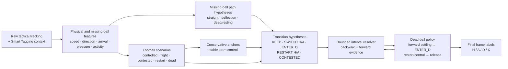

# Frame-level possession for BAR–ATH

## 1. Problem: why frame labels are difficult

The task is to label every tactical frame as Home (`H`), Away (`A`), dead ball
(`D`), or not graded (`X`). At spell level the task looks simple; at frame
level the difficult questions are *when* ownership changes and *when* play
actually stops or restarts.

The nearest player is not a possession label. It changes during passes,
deflections, challenges and poor touches. Likewise, a missing ball coordinate
does not prove either a turnover or a stoppage. We therefore treat possession
as a sequence of football events and only change a label when several
independent observations support the same explanation.

## 2. What we learned from the data (01 EDA)

The tactical data contains ball and player coordinates at 25 fps, together
with Smart Tagging phase context. The ball is frequently unobserved, and
player tracks also disappear. The public five-minute window is much easier
than the full match, so a public score is a useful audit but not a guarantee
of private-match performance.

Smart Tags are context rather than frame truth. A `SET PIECES` window can start
before the actual restart, continue after live play, or miss a stoppage. We
therefore use tags to open a region for inspection, while physical motion and
player behaviour decide the boundary.

**Why this matters.** A model that copies a tag, follows the nearest player, or
smooths across every missing-ball interval will create plausible-looking but
incorrect possession spells. The central design requirement is evidence
preservation: missing observations should create uncertainty, not invented
certainty.

## 3. Construction: measurements become football evidence (02–05)

**What we construct.** From raw tracking we calculate ball speed,
acceleration, direction change, endpoint displacement, kick episodes, nearest
player distance, team distance margin, closing speed, predicted arrival,
opponent density and player activity. Missing-ball gaps receive their own
features: the last and next visible positions, path coherence, uncertainty,
and whether the same team controls the ball on both sides.

**Why.** These measurements answer different football questions. Speed and
direction identify a kick or possible deflection; arrival and pressure say
which players could plausibly receive it; activity and separation distinguish
live play from a settling stoppage.

**How.** We combine measurements into scenarios such as `CONTROLLED`,
`PRESSURED_CONTROL`, `BALL_IN_FLIGHT`, `RECEPTION_CANDIDATE`, `CONTESTED`,
`RESTART_LIVE_BOUNDARY`, `DEAD` and `OCCLUDED`. Scenarios are evidence
contexts, not final labels. Conservative anchors then identify moments where a
team has sufficiently stable control: proximity, team separation, persistence,
slow-enough contact and low distance variation must agree. A nearest-player
change alone never becomes an anchor.

The earlier scenario lane records what the motion and visibility evidence
suggests before ownership anchors are applied. The downstream scenario lane
records the context consumed by the resolver. This preserves the distinction
between raw observations, refined evidence and final labels without duplicating
the decision rule.

## 4. The main innovation: hypothesis-test transition resolver (06–07)

The resolver is a knowledge-driven, rule-based probabilistic inference system
with model-based sequence decoding. It does not train a possession classifier
on the public labels. Its “probabilities” are normalized relative evidence
scores, not claims of calibrated truth.

### What problem it solves

A single frame cannot reliably decide whether a nearby opponent touched the
ball, whether that touch changed ownership, or whether a stopped-looking ball
is part of live play. We therefore open a bounded transition interval around
a kick, direction change, receiver approach, opposing anchor, missing-ball
gap or restart cue. The interval is evaluated as a whole, using observations
before and after the ambiguous frame.

### How the hypotheses work

For each frame or local interval we build an evidence vector containing:

`anchor`, `ball/contact`, `player arrival`, `pressure/contest`, `restart`,
`dead-ball`, `path uncertainty`, and post-touch control.

Each candidate explanation receives a score of the form

\[
S_k = \sum_j w_{kj} e_j - \sum_l v_{kl} q_l,
\qquad
P(k\mid E)=\frac{e^{S_k}}{\sum_r e^{S_r}}.
\]

The weights express football meaning: a persistent control anchor is stronger
than proximity alone; a direction change is a contact clue but not a switch;
and uncertainty or contest reduces confidence. The normalized values allow
the resolver to compare explanations and to abstain. They are not fitted
against the public labels.

The state space is deliberately explicit:

- `KEEP_CURRENT` — the apparent handoff is not yet supported;
- `SWITCH_TO_H` / `SWITCH_TO_A` — an opposing contact is followed by arrival
  and persistent control;
- `ENTER_D` — stoppage evidence is stronger than live-play evidence;
- `RESTART_TO_H` / `RESTART_TO_A` — play has activated, but landing control is
  still checked;
- `CONTESTED` — both explanations remain plausible, so the resolver does not
  force a label.

This creates three transition families rather than only `H ↔ A`:

1. **Live handoff (`H ↔ A`).** Contact or a sharp motion change starts the
   test. Backtracking and forward checking compare candidate arrival,
   pressure, contact and post-touch control. A short touch can be real, but a
   nearest-player change without control is not enough.
2. **Live play to dead ball (`H/A → D`).** Out-of-play, settling motion,
   stopped-ball evidence or a stoppage-interest collapse can enter `D`. Lack
   of pressure alone is not enough.
3. **Dead ball to live play (`D → H/A`).** Restart activation identifies when
   play may resume. The first controlled touch identifies which team owns the
   live state. A long-ball launch provides continuity for the launching team
   during flight, but it does not decide landing ownership.

The interval resolver then applies only bounded, evidence-backed changes. It
protects `X`, leaves `CONTESTED` unresolved, and avoids broad `D` rewrites. The
conservative hybrid resolver is:

`dead-ball hypothesis + forward settling → ENTER_D → restart/control release`.

In other words, a dead-ball hypothesis is not enough on its own: the forward
scene must also settle before `ENTER_D` can affect the output, and the hold is
released by restart activation or persistent control. The safe dead-ball
policy is therefore:

`dead-ball hypothesis + forward settling → ENTER_D`

then

`restart activation or persistent control → terminate D`.

This is the important distinction between *what probably happened* and *when
the final label should change*. A path hypothesis may suggest a deflection;
the transition hypothesis asks whether ownership changed; only the resolver
changes the final interval label.

## 5. End-to-end pipeline and evaluation (08–09)

The runner rebuilds the evidence table from the supplied raw tactical data and
Smart Tags. It produces the same candidate labels and reports used in the
notebooks; ground truth is read only by the evaluator after inference.

The path branch does not directly assign possession. It supplies uncertainty
and candidate receiver/contact evidence to the transition hypotheses. The
resolver is the only layer allowed to change the final interval label.

The promoted full-match candidate is the bounded three-family hybrid. It
contains the forward terminal-flight and scene-settling dead-ball evidence,
but uses it inside an explicit transition-state resolver. `ENTER_D` is opened
only when a dead-ball hypothesis is supported by a bounded forward settling
run; `D` is released only by local restart activation or persistent control,
and ambiguous evidence remains `CONTESTED`:

| Candidate | Macro-F1 | Spell-F1 | Transition F1@25 |
|---|---:|---:|---:|
| Scenario-gated control labels | 0.672 | 0.568 | 0.171 |
| + dead-ball boundary evidence | 0.772 | 0.568 | 0.333 |
| + visible-ball settling evidence | 0.889 | 0.600 | 0.444 |
| + hypothesis-based no-switch resolver | 0.892 | 0.621 | 0.457 |
| + forward-settling dead-ball onset (reference) | 0.895 | 0.640 | 0.486 |
| **+ bounded three-family hybrid (promoted)** | **0.895** | **0.640** | **0.486** |

The result is encouraging but must be interpreted cautiously: the public
window contains only 17 graded possession spells, and the full match contains
many more missing-ball intervals. We therefore prefer mechanisms that are
physically and tactically meaningful over a threshold that wins by a few
public frames. The hybrid ties the reference on all three public metrics while
changing only 435 full-match frames, compared with 1,430 changes from the
unrestricted three-family diagnostic. It is therefore the safer mechanism to
represent the method on the private full match, subject to the unavoidable
private-data uncertainty.

## 6. Missing-ball improvement: the next useful direction

An alternate-camera system can be valuable, but not as a smooth interpolation
that invents a ball coordinate at every missing frame. The useful target is a
two-way evidence process that tries to reconstruct the *same signals* we would
have used if the ball were visible. The second direction is important: once a
candidate path is proposed, downstream player motion must be allowed to reject
it or support an alternative. The target is evidence, not a prettier curve:

1. use direct observations from another view only when their provenance and
   confidence are strong;
2. compare the last and next visible tactical positions and test whether a
   straight path is plausible;
3. if not, form competing hypotheses—straight flight,
   player-supported deflection, and dead/resting path;
4. use ball displacement, direction change, travel time and likely landing,
   then check candidate receiver arrival, pressure and post-gap control;
5. pass path agreement, provenance and uncertainty downstream as evidence,
   never as a possession label;
6. extend the same idea to missing players: when the likely carrier disappears,
   compare ball travel, candidate-player backward/forward trajectories,
   pressure, convergence and the next reliable control state.

This matters because a large transition can occur while the ball is missing.
The missing-player extension is harder because both the carrier and receiver
may be unobserved. Its safe output may therefore be `CONTESTED` or continuity
rather than an invented switch. This is especially important for the case
where the ball slows in open space, then accelerates again while an opposing
player approaches but never reaches it: the prior team should remain the
continuity hypothesis until contact/control evidence says otherwise.

## 7. What we tried but did not promote

Alternative sequence decoders, duration models, fitted probability weights,
and collaborator-specific evidence adapters were useful diagnostics, but they
did not provide a reliable public improvement or an independent signal strong
enough to justify overriding the guarded resolver. Some require labelled or
event-derived training data; others changed many ungraded full-match frames
without changing the public decision. They remain useful comparison material,
not hidden inputs to the submission.

The main lesson is that the bottleneck is not a more aggressive decoder. It is
better receiver/contact evidence—especially around short touches and
missing-ball gaps. The resolver is designed to consume that evidence when it
becomes available, while remaining conservative when the evidence is
ambiguous.
